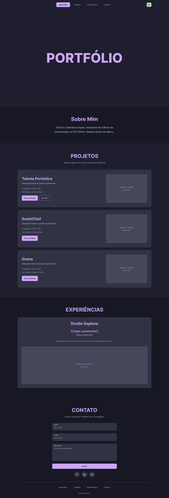
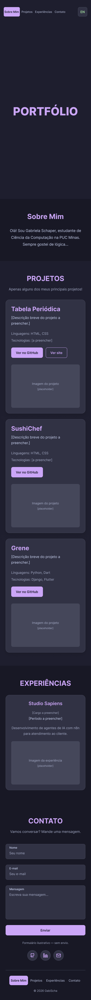
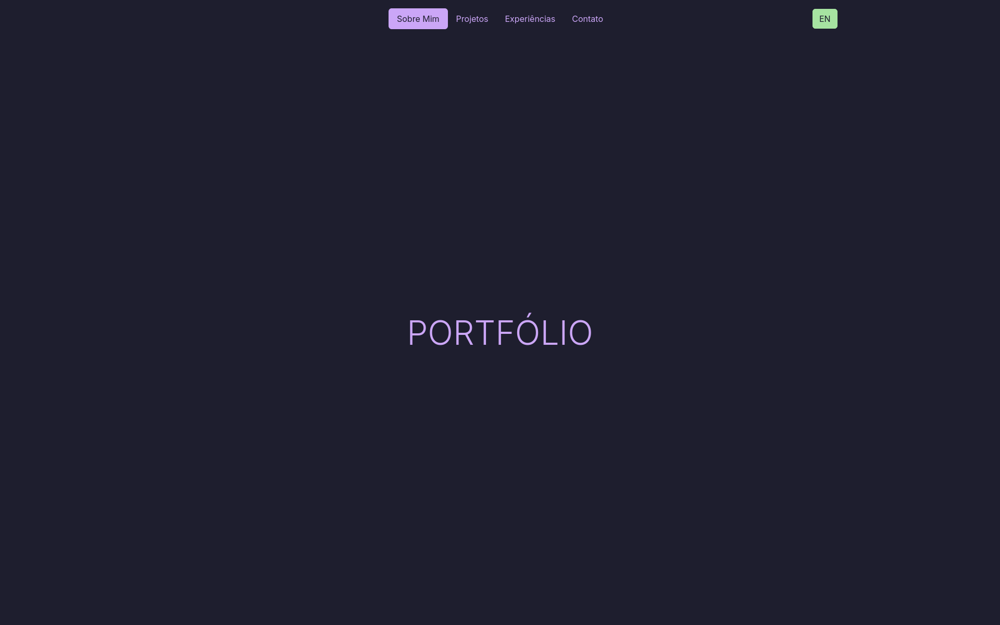
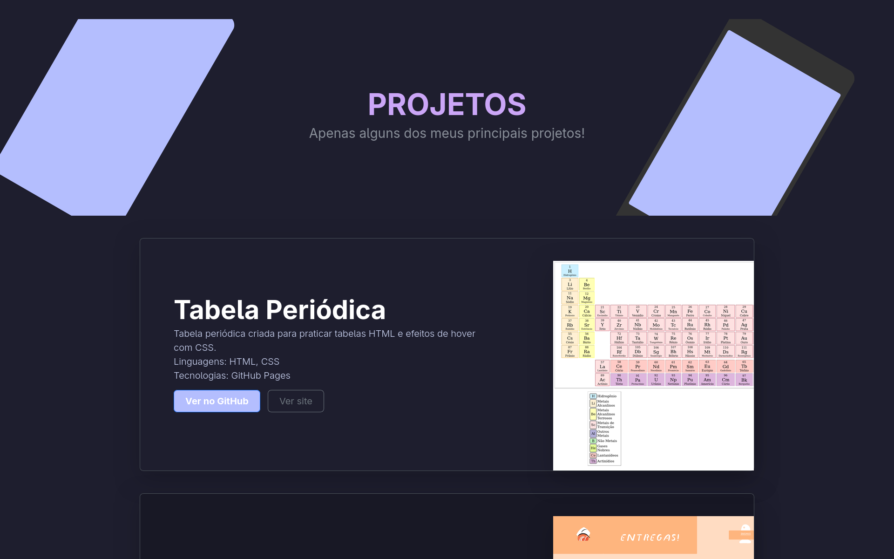
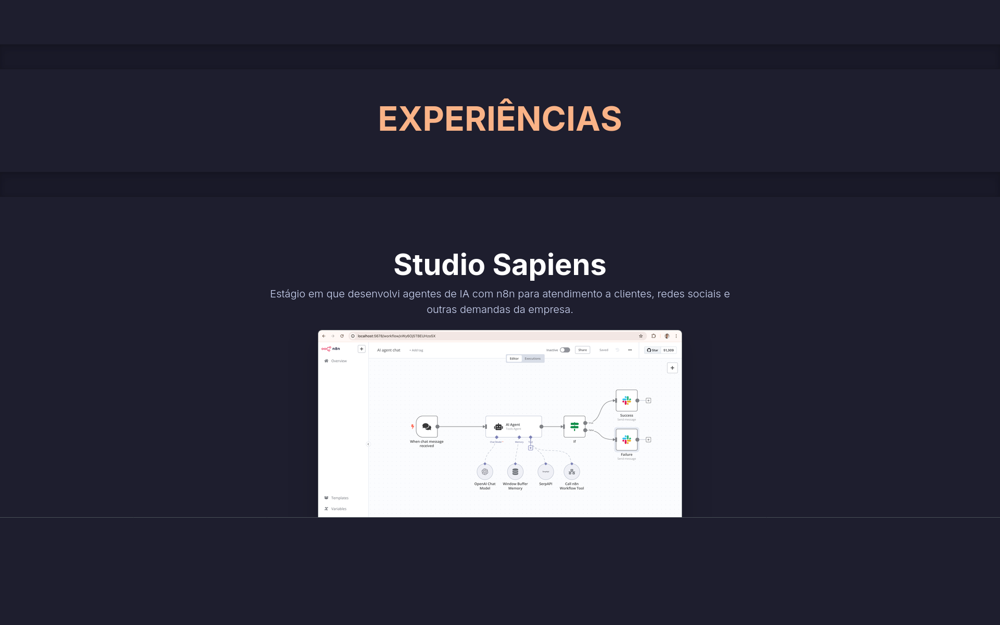
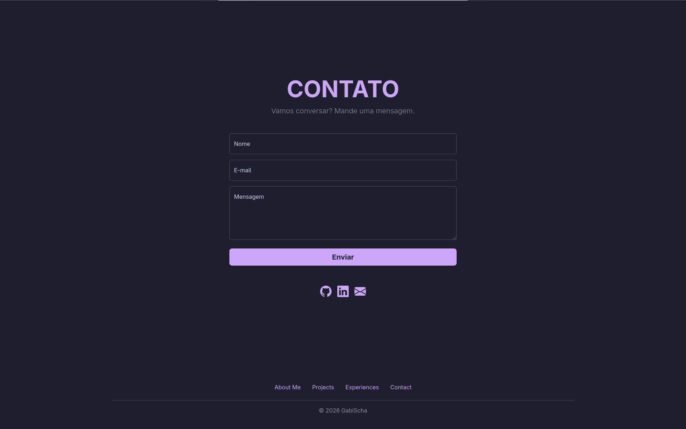

# Portfólio Profissional - Gabriela Schaper

> [!NOTE]
> Site de portfólio pessoal e bilíngue (PT/EN) para apresentar minha trajetória, projetos, experiências e formas de contato, com identidade visual baseada na paleta Catppuccin Mocha.

Projeto desenvolvido para o Laboratório 01 - Portfólio Profissional da disciplina de Desenvolvimento de Interfaces Web (DIW), do curso de Ciência da Computação da PUC Minas. O site reúne as seções Sobre Mim, Projetos, Experiências e Contato, acessadas por um menu de navegação, com design responsivo, troca de idioma e um formulário que envia mensagens para o meu e-mail.

---

## Status do Projeto

- [x] Lab01S01: planejamento, wireframes, layout principal e navegação
- [x] Lab01S02: seções funcionais, troca PT/EN e formulário de contato
- [x] Lab01S03: ajustes finais, imagens/GIFs dos projetos e animações de scroll (GSAP)


---

## Índice

- [Links Úteis](#links-úteis)
- [Sobre o Projeto](#sobre-o-projeto)
- [Funcionalidades Principais](#funcionalidades-principais)
- [Tecnologias Utilizadas](#tecnologias-utilizadas)
- [Arquitetura](#arquitetura)
- [Instalação e Execução](#instalação-e-execução)
  - [Pré-requisitos](#pré-requisitos)
  - [Variáveis de Ambiente](#variáveis-de-ambiente)
  - [Instalação de Dependências](#instalação-de-dependências)
  - [Inicialização do Banco de Dados](#inicialização-do-banco-de-dados)
  - [Como Executar a Aplicação](#como-executar-a-aplicação)
- [Deploy](#deploy)
- [Estrutura de Pastas](#estrutura-de-pastas)
- [Demonstração](#demonstração)
- [Testes](#testes)
- [Documentações utilizadas](#documentações-utilizadas)
- [Autores](#autores)
- [Contribuição](#contribuição)
- [Agradecimentos](#agradecimentos)
- [Licença](#licença)

---

## Links Úteis

- **Site publicado:** [Link do Vercel](https://portfolio-gabischa.vercel.app/)
- **Repositório:** [github.com/GabiScha/Portifolio_Diw_I](https://github.com/GabiScha/Portifolio_Diw_I)
- **Protótipo no Figma:** [Link do Figma](https://www.figma.com/design/fh0XDAZkdFiMwCgS4bZ2fC/Portfolio?node-id=0-1&t=esHnImpq1ePGTtQN-1)

---

## Sobre o Projeto

Este portfólio reúne em um só lugar quem eu sou e o que já construí. Sou estudante de Ciência da Computação na PUC Minas e busco atuar no desenvolvimento de novas tecnologias aliado à pesquisa, então o site funciona como apresentação para recrutadores, professores e colegas da área.

O projeto também foi um laboratório de aprendizado: minha primeira experiência prática com Bootstrap e GSAP, envolvendo decisões de design, organização do código em módulos, internacionalização, integração com serviço de e-mail e publicação em nuvem.

**Onde pode ser utilizado:** processos seletivos, estágios, eventos técnicos e comunidade acadêmica.

### Protótipos

Wireframes de média fidelidade criados no Figma antes da implementação.




<!-- TODO: exporte os frames do Figma como PNG e salve em docs/ -->

### Identidade visual

Tema escuro com a paleta [Catppuccin Mocha](https://catppuccin.com/palette).

| Uso | Cor | Hex |
| :--- | :--- | :--- |
| Fundo da página | base | `#1e1e2e` |
| Seções alternadas | mantle | `#181825` |
| Cards e campos | surface0 | `#313244` |
| Texto principal | text | `#cdd6f4` |
| Destaque (títulos, menu ativo, botões) | mauve | `#cba6f7` |
| Botão de idioma | green | `#a6e3a1` |

---

## Funcionalidades Principais

- **Navegação por menu:** links para cada seção no cabeçalho, repetidos no rodapé.
- **Internacionalização (PT/EN):** botão que traduz todo o conteúdo e lembra a escolha na próxima visita.
- **Projetos:** em ordem cronológica, cada um com descrição, linguagens, tecnologias, link do GitHub e imagem/GIF.
- **Experiências:** empresa, atividade, período e descrição.
- **Formulário de contato:** campos de nome, e-mail e mensagem com validação, enviando a mensagem para o meu e-mail via EmailJS, com aviso de sucesso ou erro.
- **Links de contato:** ícones clicáveis para GitHub, LinkedIn e e-mail.
- **Design responsivo:** layout adaptado de celulares a telas grandes, usando o grid do Bootstrap.
- **Animações com GSAP:** animações de entrada e de scroll (em desenvolvimento).

---

## Tecnologias Utilizadas

### Front-end

- **Linguagens:** HTML5, CSS3 e JavaScript (ES Modules)
- **Interface:** [Bootstrap 5.3](https://getbootstrap.com/docs/5.3/) e [Bootstrap Icons](https://icons.getbootstrap.com/)
- **Animações:** [GSAP](https://gsap.com/)
- **Envio de e-mail:** [EmailJS](https://www.emailjs.com/)
- **Build Tool:** [Vite](https://vite.dev/)
- **Paleta de cores:** [Catppuccin Mocha](https://catppuccin.com/)

### Infraestrutura

- **Hospedagem:** Vercel
- **Versionamento:** Git e GitHub
- **Protótipos:** Figma

O projeto não possui back-end próprio: o envio de e-mails é feito por um serviço externo (EmailJS), acessado direto do navegador.

### Dependências e bibliotecas

Instaladas via npm (listadas no `package.json`):

| Pacote | Uso |
| :--- | :--- |
| `gsap` | animações |
| `@emailjs/browser` | envio do formulário por e-mail |
| `vite` (dev) | servidor de desenvolvimento e build |

Carregadas via CDN no `<head>` do `index.html`:

| Biblioteca | Versão | Uso |
| :--- | :--- | :--- |
| Bootstrap (CSS) | 5.3.0 | layout, grid e componentes |
| Bootstrap Icons | 1.11.3 | ícones de contato |

---

## Arquitetura

O site é uma página única estática, sem back-end próprio. O JavaScript é dividido em módulos, cada um com uma responsabilidade:

| Módulo | Responsabilidade |
| :--- | :--- |
| `index.html` | estrutura de todas as seções |
| `src/style.css` | paleta Catppuccin e ajustes sobre as variáveis do Bootstrap |
| `src/i18n.js` | dicionário PT/EN e troca de idioma (elementos com `data-i18n`) |
| `src/contato.js` | validação e envio do formulário via EmailJS |
| `src/main.js` | ponto de entrada: importa o CSS e inicia os módulos |

**Decisões de design:**

- Bootstrap cuida da estrutura (grid e espaçamento), e as cores da paleta são aplicadas sobrescrevendo as variáveis `--bs-*`.
- Tradução por dicionário em JavaScript, com um único HTML, em vez de duas páginas duplicadas.
- EmailJS permite enviar e-mails reais sem manter servidor, compatível com hospedagem estática gratuita.

---

## Instalação e Execução

### Pré-requisitos

- Node.js (versão LTS, v18 ou superior)
- npm (incluso no Node.js)
- Git

### Variáveis de Ambiente

O projeto não usa variáveis de ambiente. As credenciais do EmailJS ficam no início de `src/contato.js`; a Public Key é pública por natureza. Para usar a sua própria conta:

1. Crie uma conta em [emailjs.com](https://www.emailjs.com/) e conecte um serviço de e-mail (Email Services).
2. Crie um template (Email Templates) com as variáveis `{{nome}}`, `{{email}}` e `{{mensagem}}`, e `{{email}}` no campo Reply To.
3. Copie o Service ID, o Template ID e a Public Key e cole em `src/contato.js`:

```js
const SERVICE_ID = 'seu_service_id'
const TEMPLATE_ID = 'seu_template_id'
const PUBLIC_KEY = 'sua_public_key'
```

Recomenda-se restringir no painel do EmailJS os domínios autorizados a usar a chave.

### Instalação de Dependências

```bash
git clone https://github.com/GabiScha/Portifolio_Diw_I.git
cd Portifolio_Diw_I
npm install
```

### Inicialização do Banco de Dados

Não se aplica: o projeto não utiliza banco de dados.

### Como Executar a Aplicação

```bash
npm run dev
```

O site ficará disponível em http://localhost:5173 (ou na porta indicada no terminal).

Para gerar a versão de produção e conferi-la localmente:

```bash
npm run build
npm run preview
```

---

## Deploy

O site é hospedado na Vercel, com publicação automática a cada `git push` na branch `main`.

1. Envie o projeto para um repositório no GitHub (`node_modules` não é versionado).
2. Na [Vercel](https://vercel.com/), clique em Add New > Project e importe o repositório.
3. Confirme as configurações detectadas: Framework Preset **Vite**, Build Command `npm run build`, Output Directory `dist`.
4. Clique em Deploy.
5. No EmailJS, adicione o domínio `*.vercel.app` do projeto à lista de domínios permitidos, caso haja restrição.

**Link do site publicado:** [link do Vercel](https://portfolio-gabischa.vercel.app/)

---

## Estrutura de Pastas

```
Portifolio_Diw_I/
├── docs/                  # wireframes, capturas de tela e GIFs usados neste README
├── src/
│   ├── assets/            # imagens e GIFs dos projetos e experiências
│   ├── contato.js         # validação e envio do formulário (EmailJS)
│   ├── i18n.js            # dicionário PT/EN e troca de idioma
│   ├── main.js            # ponto de entrada
│   └── style.css          # paleta Catppuccin e ajustes sobre o Bootstrap
├── .gitignore             # ignora node_modules e dist
├── index.html             # página única com todas as seções
├── package.json           # dependências e scripts
├── package-lock.json      # versões exatas das dependências
└── README.md              # documentação do projeto
```

---

## Demonstração

<!-- TODO: salve os prints e GIFs em docs/ com estes nomes (ou ajuste os nomes abaixo) -->

### Aplicação Web






---

## Testes

O projeto não possui testes automatizados nesta versão. A verificação foi feita manualmente: navegação entre seções, troca de idioma, validação e envio do formulário, e responsividade em diferentes tamanhos de tela.

---

## Documentações utilizadas

- [Bootstrap 5.3](https://getbootstrap.com/docs/5.3/)
- [GSAP](https://gsap.com/docs/)
- [Vite](https://vite.dev/guide/)
- [EmailJS](https://www.emailjs.com/docs/)
- [Catppuccin Palette](https://catppuccin.com/palette)

---

## Autores

| Nome | GitHub | LinkedIn | E-mail |
| :--- | :--- | :--- | :--- |
| Gabriela Schaper | [GabiScha](https://github.com/GabiScha) | [Perfil](https://www.linkedin.com/in/gabrielaschaper/) | gabrielasch2409@gmail.com |

---

## Contribuição

Projeto acadêmico individual, sem abertura para contribuições externas no momento. Sugestões podem ser enviadas por issue no repositório.

---

## Agradecimentos

- [Engenharia de Software PUC Minas](https://www.instagram.com/engsoftwarepucminas/): pelo apoio institucional e estrutura acadêmica.
- [Prof. Dr. João Paulo Aramuni](https://github.com/joaopauloaramuni): pela proposta do laboratório e pelo template de README.
- [Catppuccin](https://catppuccin.com/): pela paleta de cores que dá identidade ao site.
